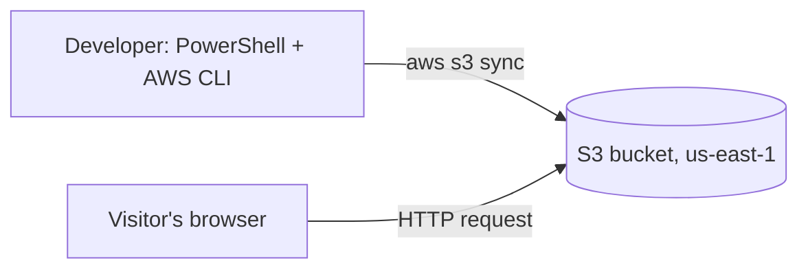
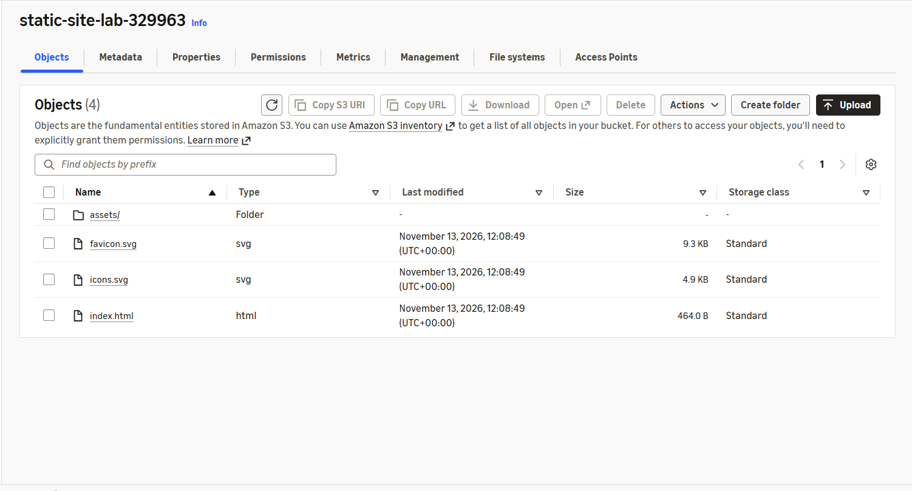
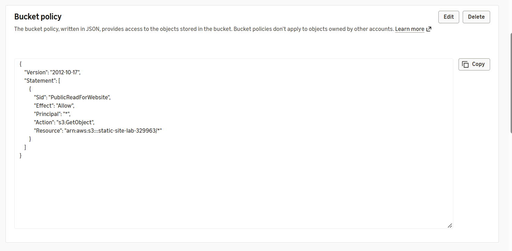

# AWS S3 Static Website

A small React (Vite) site hosted on Amazon S3 static website hosting and deployed with the AWS CLI.

> **Status:** completed learning project. The bucket was deleted after testing; the screenshots show the live deployment. Not production-ready (see Security considerations).

## Overview

This project hosts a static frontend with no servers to manage. The site is built locally into plain files, uploaded to an S3 bucket, and served through S3's website endpoint.

## Learning objectives

- Create and configure an S3 bucket from the CLI
- Understand S3 website hosting and why the endpoint is HTTP only
- Understand the two access layers: Block Public Access and bucket policies
- Apply least privilege (public `GetObject` only)
- Use temporary credentials with `aws login` instead of access keys

## Architecture




## AWS services and technologies

- Amazon S3 (static website hosting, bucket policy, Block Public Access)
- AWS CLI v2
- React, Vite, Node.js, Git/GitHub

## Prerequisites

- An AWS account with a non-root IAM user and MFA
- AWS CLI v2 (2.32 or newer) signed in with `aws login`
- Node.js (current LTS) and Git

## Deployment (PowerShell)

```powershell
npm install
npm run build

$BUCKET = "your-globally-unique-bucket-name"
aws s3api create-bucket --bucket $BUCKET --region us-east-1
aws s3 sync dist s3://$BUCKET --delete
aws s3 website s3://$BUCKET --index-document index.html

aws s3api put-public-access-block --bucket $BUCKET --public-access-block-configuration "BlockPublicAcls=true,IgnorePublicAcls=true,BlockPublicPolicy=false,RestrictPublicBuckets=false"

(Get-Content infra\bucket-policy.template.json) -replace 'YOUR-BUCKET-NAME', $BUCKET | Set-Content bucket-policy.json
aws s3api put-bucket-policy --bucket $BUCKET --policy file://bucket-policy.json
```

Site address: `http://<bucket-name>.s3-website-us-east-1.amazonaws.com`

## Testing and verification

- `curl.exe -I http://<bucket>.s3-website-us-east-1.amazonaws.com` returns `200 OK`
- Anonymous bucket listing and uploads return `403 AccessDenied`





## Security considerations

- Bucket is publicly readable by design: only `s3:GetObject` is allowed
- Block Public Access was relaxed for this one bucket, not the account
- S3 website endpoints do not support HTTPS; a CloudFront distribution with a private bucket is the better design
- No credentials are stored in this repo; `bucket-policy.json` and `.env` files are git-ignored

## Cost considerations

Costs for a site this size are expected to be a fraction of a cent (storage, requests, data transfer). Check current prices at https://aws.amazon.com/s3/pricing/ and delete the bucket after testing.

## Cleanup

```powershell
aws s3 rb s3://$BUCKET --force
```

## Lessons learned

- **S3 public access has two layers.** Block Public Access is a safety gate which can only stop access, the bucket policy is what actually permits it. Turning off the gate alone still gave a `403` and the site wouldn't load until a s3:GetObject policy was attached. That's why I've only relaxed the two settings which block public policies for this one bucket, and left the ACLS alone.
- **S3 has two endpoints with different behaviour.** The REST endpoint (`s3.amazonaws.com`) is an API, so anonymous listing and uploads were refused with `403`. The website endpoint (`s3-website-us-east-1...`) serves `index.html`, but over HTTP only. That limitation is the main reason a production site should use CloudFront in front of a private bucket.
- **Use an IAM user and temporary credentials, not root and access keys.** I did the work as an IAM user with MFA and logged in via `aws login` so there were no long term keys to leak. As root you have to explicitly enable IAM access to the billing information, as an admin user can't do that.
- **Keep the repo reproducible and safe.** The actual bucket policy doesn't get committed to the repo. A template with a placeholder is committed instead and the generated file is ignored by Git.
- **Cost control is a habit.** I'll set up budget alerts prior to creating anything, keep the site itself tiny and delete the bucket once we've tested it as budgets and alerts are notoriously behind actual usage.
